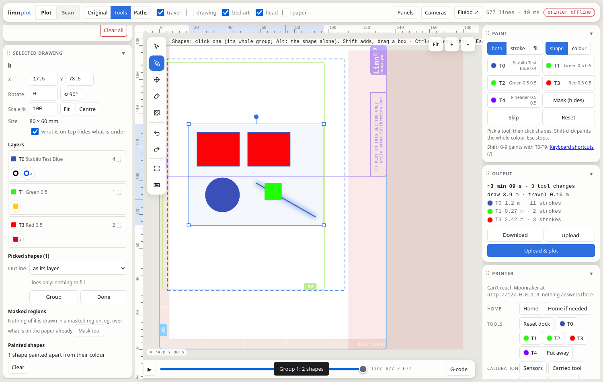
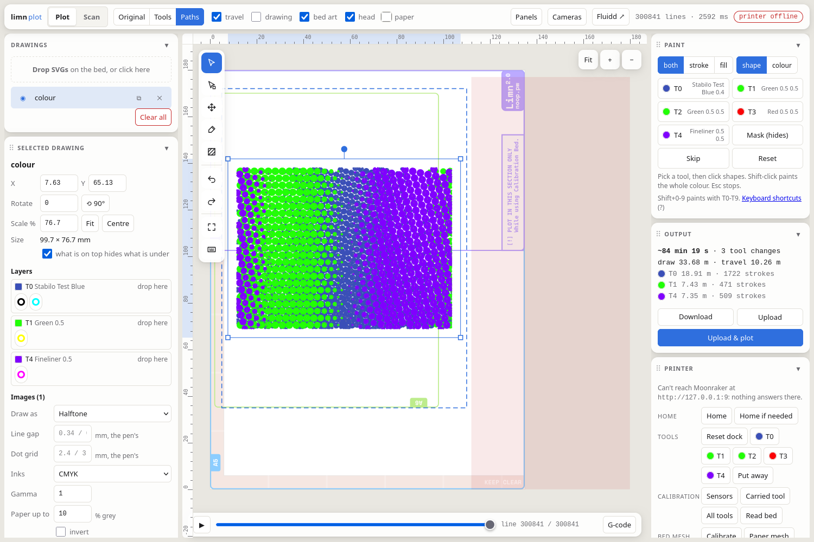
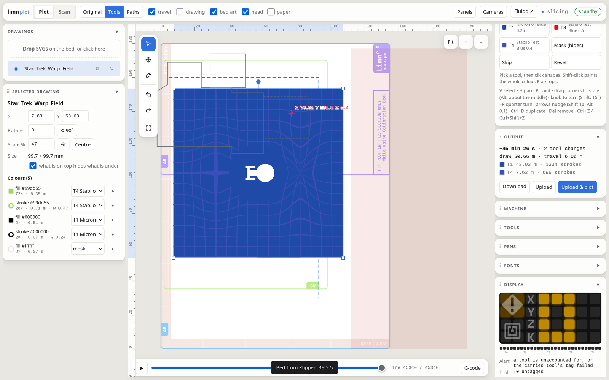
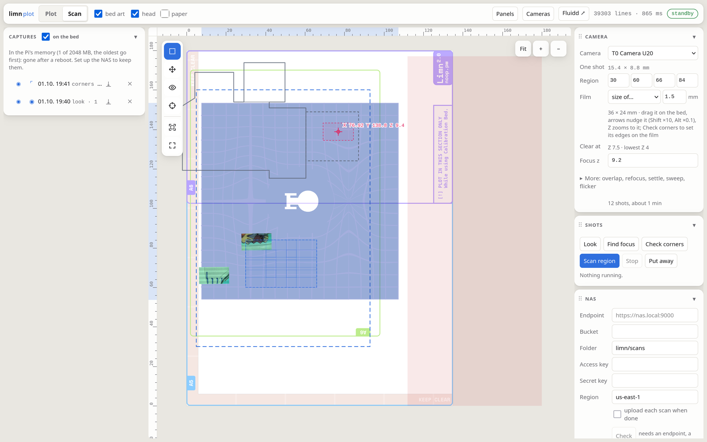

# Changelog

All notable changes to Limn, a pen plotter with an automatic toolchanger, built from the parts of an old RepRap-style printer and running Klipper.

The format follows [Keep a Changelog](https://keepachangelog.com/en/1.1.0/). Versions are dates (`YYYY.MM.DD`), each one a milestone. Entries come from the git history and from the build logs on [Hackaday.io](https://hackaday.io/project/205431-limn-pen-plotter-with-toolchanger) (marked 📓). Hardware changes are marked 🔧.

- Repository: [prashnts/limn](https://github.com/prashnts/limn)
- Printed parts: [Printables](https://www.printables.com/model/1786450-limn-pen-plotter-with-automatic-tool-changer-parti)

## Milestones

| Version | Milestone |
|---|---|
| 2026.03.31 | Project started on Hackaday.io |
| 2026.04.03 | Repository created; toolhead and Z axis reworked |
| 2026.04.11 | Source published on GitHub: Klipper config, toolchanger, RFID tags |
| 2026.04.15 | First real multi-pen plots from SVG |
| 2026.04.24 | Lead-screw Z axis, magnetic A5 bed; STEP/Fusion360 files published, license changed to GPL v3 |
| 2026.05.01 | Tool offsets read from RFID tags; tethered tools |
| 2026.05.12 | Tools aligned automatically in XYZ on a resistive touch panel |
| 2026.05.21 | First Limn Klipper extension |
| 2026.05.26 | Bed and dock MCUs on MicroPython firmware |
| 2026.06.13 | Pen calibration works end to end (~0.2 mm), calibrated plotting |
| 2026.08.13 | Dock rework: holder switches, protected RFID tags; Printables project |
| 2026.08.16 | ToF sensing tried for dock calibration |
| 2026.09.06 | Loose belts fixed; web server for the plotter state |
| 2026.09.23 | FSR bed (BED_4) and bed detection on the Dock |
| 2026.09.27 | First AI-assisted work: bed MCU chain, tool holders and LEDs in the extension |
| 2026.09.30 | Limn's own SVG → G-code generator and web UI replace PrusaSlicer; cameras measure where each pen touches (`limn_cam`) |
| 2026.10.01 | Scanning for film (Hugin, flicker, NAS); the plot UI over the canvas; the LED display, live |
| 2026.10.07 | Pen layers and groups; pictures as dither and halftone; the FSR calibration measured on the plotter |
| 2026.10.11 | Camera calibration, pens swapped mid-plot, wipe area; FSR sheet loaded and recalibrated |

---

## [2026.10.11] - Camera calibration, pens for the plan, FSR sheet loaded

### Added
- **Camera calibration** (the Scan tab's *Calibration cross* and *Calibrate*, `Job.calibrate` in `limn_cam/scan.py`): a camera's `fov`, `turn`, `focus_z` and `center` are measured instead of set by hand. A 12 mm cross is plotted with a pen; the job sweeps the focus, shifts the view by 0.5 mm and by a quarter shot (phase correlation), finds the cross for the offset from the tool point and checks it with a second look. *Save* writes the values into the camera's entry in `pens.toml`. Made for the hand-docked Pi camera (`limn_picam`); the README's *Adding a camera* says how.
- **Pens for the plan** (`job.pens`, `profile.plan_pens`): pens not in the dock appear as T5, T6, .., painted like any tool. A pen a holder already has is drawn by it; the others are swapped into a free holder by hand mid-plot (`emit.swaps`), so there can be more colours than holders.
- **Pens swapped by hand mid-plot** (`TOOL_SWAP`, ext/limn): the carried pen goes back, the carriage waits over the paper and the print pauses until the pen asked for is scanned into that holder. `RESUME` takes whatever is in it.
- **A new pen is probed before it plots** (`TOOL_PREPARE`): a pen whose tag has no offsets, or one swapped in with *probe it*, is measured on the bed's sensor first and its offsets written to its tag. A bed that can't measure it pauses the plot.
- **The wipe area** (`beds.py` `wipe`, `LRT_WIPE [RESET=1]`, `TOOL_PRIME`): off the paper towards the dock, where pens are primed and test marks go. Full, it beeps and asks for a fresh pad (*New pad*). Drawn on the bed in the UI. BED_5's is a placeholder (X96–108, Y40–160), switched off until measured.
- **The plot's plan** (Output panel): every step before it is sent, with the clock (pens picked up, primed, probed, swapped); a click goes to that step in the Paths view.
- **Layers over all the drawings**: every pen's layer in plotting order, with an eye to hide it from the canvas and Paths view. Drag a pen to plot it earlier or later (`job.tool_order`); *Auto order* goes back to light first.
- **A picture's own colours** (`separate = "palette"`): its main colours by median cut, each a layer with its own pen. **Each picture its own settings** (`Obj.images`): mode, inks, grid and tone per picture.
- **A job saved as a file** (*Save job*, *Open job…*, Ctrl+Shift+S, or drop it on the page): the job, its SVGs and fonts in one `.limnplot.json`.
- 🔧 **47k load resistors on BED_5's FSR rows** ([`1fd2e8c`](https://github.com/prashnts/limn/commit/1fd2e8c)): the sense rows had floated all along. A 47k from each row (GP26–29) to GND and `"fsr_load": 47000` in `nodes/fsr.json`. At rest every cell now reads 0 (it was ≤ 130 and drifting) and row 3 answers like the others, at the cost of about a third of the signal. Pinout in `notebooks/pinout.md`.
- 🔧 **`dz_trim`** (`beds.py`; `DZ_TRIM=` on `LRT_CALIBRATE` and `LRT_PROBE_TOOL`; [`b78402a`](https://github.com/prashnts/limn/commit/b78402a), 0.3 since [`48c60e8`](https://github.com/prashnts/limn/commit/48c60e8)): every FSR tag's dz is taken down alike, because the reference's first test mark at Z1 drew nothing. With contact measured right again, trim 0.1 left the Stabilo off the paper; 0.3 (dz 0.31) gives complete marks.

### Changed
- 🔧 **The FSR measurement reworked** ([`07c6df1`](https://github.com/prashnts/limn/commit/07c6df1), [`b78402a`](https://github.com/prashnts/limn/commit/b78402a); `notebooks/act-9-fsr-rework.md`): no decision hangs on one cell against a threshold. Contact is the rise onset of any cell (`early`), confirmed by its growth; an edge is a sweep of taps across two cells, each voting by the second cell's share, the border where the fewest disagree (`border()`, with its sigma). `LRT_PROBE_TOOL` writes no tag for a pen measured less sure than `max_sigma` (0.15 mm).
- 🔧 **FSR thresholds rescaled to the loaded sheet** ([`1d31142`](https://github.com/prashnts/limn/commit/1d31142)): `press_strength` 120, `respond` 60, `early` 30, `sure` 150, `locate_strength` 70, `press_limit` 600. Taps press 0.2 mm past contact at most (`TAP_PRESS`), less for a pen with a smaller `press_max`.
- 🔧 **The calibration measures on the sheet's strong cells, two edges an axis** ([`1602049`](https://github.com/prashnts/limn/commit/1602049)): z on (1, 6), X edges (1, 6)|(2, 6) and (2, 5)|(3, 5), Y edges (1, 6)|(1, 7) and (1, 3)|(1, 4). Each axis is the mean of its two borders, and their disagreement goes into its sigma (`edge_tips`). About 2.5 min more a pen.
- **Pens drying out only count while the machine leaves them alone** (`drying.py`): a print, running G-code or a tool change stops every pen's clock, so nothing beeps while the pens are wanted. It beeps once a minute (`tool_dry_beep` 60, was 3); `tool_dry_printing` is gone.
- **Keyboard shortcuts alike on both tabs**: `0` fits the bed, `Z` zooms to the selection, `V` is the tab's own tool, `H` pans, `Esc` steps back; the help (`?`) groups them. The selected drawing's panel folds, and texts are grouped by style.
- The plot UI runs on the PC (`limn_plot_pc.conf`, :4221): on the Pi it lagged.
- **Reslicing is cached at more levels** (path order per pen, fills by area and settings, G-code read back once), so moving a drawing or changing one thing of it doesn't redo the rest: the Bicycle diagram 5.8 s → 1.7 s. Pens write a stroke's G-code all at once; a 120 × 90 mm halftone moves in ~1.5 s.

### Fixed
- 🔧 **FSR contact came out low when a crosstalk cell led** ([`1602049`](https://github.com/prashnts/limn/commit/1602049); `Fsr.growth`): a touch was confirmed by the strongest cell growing, and row 3's (3, 1) rising at first touch got two of three contacts taken for readings in the air (0.12–0.18 mm low). Now each cell's growth over its own onset reading counts. On the plotter: 3.620 / 3.625 / 3.622, spread 0.005, the reference 0.620 over the BLTouch (10-09: 0.610). Notes: `notebooks/act-10-fsr-loaded.md`.
- **A Micron 01 probed against the new reference** (2026-10-10): with a Micron 005 Black as the reference (holder 45), the Micron 01 Blue gave up once on the X edge and passed the next run (dx −4.02, dy −0.88, dz 1.87). Every other pen's tag was against the Stabilo and is to be probed again.
- **Halftone dots too big**: the dot grid followed 6 of the pen's lines (now 4, to 2 mm), and with *Its colours* a colour was drawn solid whatever the pen; it is as dark as the colour now, in the pen's ink. On a map of Delhi the median dot went from 1.8 to 0.9 mm.
- **Halftone and lines slice in seconds** (`plot/slicer.py`): a picture's lines were taken for strokes and every spiral was made an area and thinned. A 40 × 30 mm picture took 235 s; now ~2 s, and a 120 × 90 mm halftone that never finished takes ~3 s.
- **The dark ink over the light** where they overlap uncut: pens plot light first unless the order is set.
- **Press again**: a button that asks twice stays armed for 4 s (was 2) and its label always comes back.
- Following Klipper's bed no longer clears the bed while Klipper hasn't read it; an SVG with only pictures loads; the LED legend no longer throws before its panel is drawn.

### Known issues
- **A fine tip on the loaded FSR sheet**: a Micron 01 read 0–80 at 0.10 mm and an edge failed then passed. Taps now go to 0.2 mm on the strong cells, not yet tried with Microns; a 100k load would give more signal.
- (1, 0) reads 20–120 for a press anywhere along row 1 (the column-0 leak).
- The taps' depth is found before the tip is known (~1.3 mm off in Y), so both spots can fall on a border's dead zone and the Stabilo taps the whole 0.2 mm.
- Both X edges run before a Y edge, each missing its first two lines (~40 s each); to interleave.
- The FSR's sigma under-reports run to run (X 0.17 mm against ±0.01 claimed); with two edges an axis it holds their disagreement (±0.04), run-to-run still to check.

## [2026.10.07] - Pen layers, pictures as halftone, the FSR calibration measured

### Added
- **Layers by pen** (the selected drawing's *Layers*): one per pen, with the colours it draws as chips; drag a chip onto another pen, or click it for its settings. It replaces the table of colours.
- **The shapes tool** (`A`): pick shapes by click, Shift-click or a box. *Pen* puts the whole shape on one pen, *Outline* and *Fill* set them apart; a closed shape without a fill can take one.
- **Bleed margin** (`inset`, per shape, group or colour): a fill kept its pen's `bleed` inside its own edge with round corners, its border along that inner edge (`geometry.margin`).
- **Groups**: shapes of a drawing (`Obj.sets`) and drawings on the bed (`Obj.group`, which move, nudge and hide together, one undo step). Ctrl+G, Ctrl+Shift+G.
- **Pictures in an SVG become plottable** (`plot/raster.py`, `Obj.raster`): on upload the UI asks whether to leave them out or make them into lines; the drawing's *Images* changes it after.
  - *Dither* (Floyd–Steinberg), *lines* (rows, denser where darker), *halftone* (dots, each a spiral).
  - Inks: one colour, CMYK, or unmixed onto the pens there are; each ink is a layer on its own screen angle.
  - Pitch and dot grid follow each ink's pen; a paper threshold keeps light backgrounds clean; gamma and invert.
  - On a 120 × 90 mm picture: lines ~1 h, halftone ~4 h, dither many hours.
- Captures: *Hide all* / *Show all* and *Delete all*. A new `ball` pen (ballpoint, presses 0.35 mm).
- 🔧 **The FSR calibration checked against the plotter** (depth ladders, scans and contact maps by hand with the Stabilo, `~/limn-shot/fsr-2026-10-07-manual.*`), and the tests' simulated sheet fitted to them. BED_5's (1, 1) reads 112 → 523 over 0.01 → 0.10 mm past first touch; (2, 4) and (1, 4) are weak; column 3 reads 360 while its row is pressed.
- 🔧 **`LRT_FSR_MAP`** (`ext/limn/fsr_map.py`): which cell answers where, the sheet touched spot by spot: each cell's centre, the array's origin and pitch fitted to them and refined by edge searches, silent or misplaced cells, the sheet's height; JSON and SVG in `fsr-maps/`. Set `origin` from it after a swap.
- 🔧 **`LRT_FSR_SURVEY`**, for a new sheet: every cell pressed by the reference pen (0.08 mm past first touch at most), read as its rise over a baseline taken in the air right above it. Faulty cells aren't read from then on, weak ones are reported, and `early` and the aim come from the survey. Saved per bed (`lrt_fsr_survey`).
- 🔧 Every FSR descent reads the sheet in the air first and goes by the rise over that (`Fsr.baseline`); the FSR measurements say on the console what they do, `VERBOSE=1` every tap too.
- 🔧 A calibration is saved without `SAVE_CONFIG`: `LRT_CALIBRATE` and the meshes are kept in the saved variables (`lrt_profile`, `lrt_mesh_data`) and put back at startup.

### Changed
- 🔧 The FSR taps press 0.1 mm past contact at most (were 0.3), and no descent goes deeper than the taps: after the first, every descent is in 0.02 mm steps. `PRESS=` overrides on `LRT_CALIBRATE`, `LRT_PROBE_TOOL` and the `LIMN_*_CALIBRATE` macros. At 0.15 the Stabilo's contact came out 0.14 mm low; at 0.1 three runs agreed.
- 🔧 `locate()` aims at column 6.3, not 5.5, where the cells are strong and away from columns 3 and 4; the `lrt_fsr` mesh ends at y 57 (its row at 59 was the sheet's edge, 0.2 mm low); row 3 is read again (`dead_rows` empty).
- 🔧 BED_5's config is back to a fresh sheet's: the old sheet, damaged by its transfer and by the tests, is to be replaced. The tests keep it as a fixture (`bed5=True`) and model a fresh one (`fresh=True`).
- Pens touch the paper lightly: fineliners press 0.1 mm (were 0.15), the Stabilo 0.15 (was 0.3).
- `<image>`s stay in an uploaded SVG (left out unless made into lines); a page's full-page background rectangle is the paper; a *look* is temporary.

### Fixed
- 🔧 `locate()` measured towards the dead row 3 and put the tip 1.3 mm too far in X; it avoids dead rows and faulty columns now. A pen that lands on another cell than aimed at is aimed again by that cell (twice at most), and a stop needs two readings to agree.
- 🔧 The three repeated touches on the measuring cell came down in 0.1 mm steps, pressing the pen in for nothing.
- Fills written as CSS `var()` take their fallback and `url()` patterns are left out (both came out solid black); ordering many strokes was quadratic (60 000 dashes: 54 s → ~1 s); a picked shape's new outline pen left its fill on the old pen.

### Known issues
- The `locate()` estimate still varies (Y 1.52 – 1.68 for 2.13 at 0.1 mm taps); the re-aim covers it.
- A fine pen's own response on the FSR isn't measured yet (the test fineliner is bent).
- Halftone and dither on the plotter: pitch, blotting in the spirals' middles and real plot times untried.

## [2026.10.01] - Scanning film, the plot UI over the canvas, the LED display

### Added
- **Scans kept in RAM, and on the NAS**: captures live in `/dev/shm` (2 GB at most, the oldest go first), so the Pi's SD card isn't worn. They upload to an S3 bucket (OpenMediaVault's S3, MinIO) through `limn_cam/nas.py`, which signs its own requests: no boto3. Settings in the Scan tab's *NAS* panel (`plot-data/nas.json`).
- **Hugin stitching** (`limn_cam/hugin.py`, the viewer's *Hugin*): features on contrast-stretched copies, mismatches left out; the camera's real scale and turn measured from all the overlaps, then the tiles only slide, plus the lens's barrel; enblend lays the seams. On the sticker test: 0.31 px RMS, tiles within 0.32 mm of where they were sent. Needs `sudo apt install hugin-tools enblend` on the Pi.
- 🔧 **Flicker detection in every shot** (`limn_cam/flicker.py`): a PWM-dimmed light leaves dark bands across a rolling-shutter shot. They are found per column and taken out with the brightest of 3 frames (1.2 → 0.44 grey levels). The Scan tab warns, and each tile records it.
- **A region for film**: presets (35 mm, 120 6×4.5 – 6×9, 4×5 in, mounts) with a margin; the region drags and resizes on the bed; *Check corners* takes 4 shots with the region's edges drawn over them, a click sets a corner to 0.05 mm.
- 🔧 **The head, live on the canvas**: Klipper's position, the toolhead's outline from above (`plot/profiles/toolhead.svg`), a crosshair at the carried tool's tip, and the camera's view while it is on.
- 🔧 **The LED display** (*Display* panel): the LED matrix UI (a Unicorn pHAT, 8 × 4) and the dock strip, live from the LEDs' colours in Klipper (`printer.limn.leds`). Documented in the README, art in `docs/led-matrix-ui.svg`.
- **The plot UI over the canvas**: the canvas is the whole page and the panels are cards over it, which fold, move or hide (`\`). The scan viewer and cameras are windows. Built for touch (two fingers pan and zoom), numbers in monospace, rarely needed settings under *More settings*.
- Klipper's cameras in an overlay and a link to Fluidd; each drawing and scan shows or hides, and several scans can lie under the plot. Browser tests (Playwright, `uv run --group ui pytest plot/tests/test_ui.py`).

### Changed
- The Paths view shows only the G-code, the drawing as a faint outline with *drawing*. The overhead camera gives 800 × 600 snapshots, its mapping onto the bed fitted again (`GEOMETRY.md`).

### Fixed
- Painting missed thin lines: shapes are picked within 6 px, hover shows which, a miss says so.

### Known issues
- The camera's scale: Hugin measured 119.9 px/mm, `pens.toml` says 125.9 (before the tube was lengthened).
- The new light flickers: taken out in software, best fixed at the light.
- The Pi needs Klipper restarted for the LED states, and the plot UI pulled and restarted (`limn_web`).

## [2026.09.30] - Limn's own plot generator, cameras, hand-scanned pens

### Added
- **`plot/`, Limn's own SVG → G-code generator** (2026-09-29), with a web UI (FastAPI + one page) to place, paint, preview and plot drawings. The draw area follows the placed bed's `lrt_paper` mesh; text uses the source font or a single-line font; per-segment tool painting; Z limits per machine, tool and job; travel stays close to the meshed paper. `GEOMETRY.md` says where everything is, in plotter coordinates.
- **Tool handling in the plot UI**: pen profiles (`plot/profiles/pens.toml`), and the UI shows which pen sits in which holder. The web UI runs on the Pi under supervisord, port 4219 (`limn_web.conf`).
- **`limn_cam`, a camera library**: the auto Z ladder finds where each pen touches the paper from a photo (`python -m limn_cam ladder T0 T1`) and writes it to the pen's tag; also homographies, the ink map, ArUco tags, Moonraker snapshots, and `limn_cam/play.py` for the pen's play. Write-up: `notebooks/act-7-camera-ladder.md`.
- **Camera scans of the bed**: `limn_cam/scan.py` and `stitch.py` stitch the bed together from camera frames; the plot UI gets a scan view (`plot/static/scan.js`).
- **Pen drying timers**: a known pen out of its cap too long (`dry` minutes per pen in `pens.toml`) blinks its holder and beeps. `TOOL_DRY` shows the clocks.
- 🔧 **Hand-scanned pens**: hold a pen to the PN532 reader, then drop it into a holder within 8 s. The extension listens in the background and the UI LEDs show the scan state (`klipper/leds.cfg`).
- FSR alignment: finer XY resolution and calibration (2026-09-28), with `notebooks/act-6-fsr-alignment.md` on whether BED_5 needs a second array.

### Changed
- 🔧 **The `G1` ACT/ALIGN macro hacks are gone**: `plot/` writes the pen moves itself, so the Klipper `G1` override from 2026.05.01 is removed from `klipper/limn.cfg`. `slicer/` (PrusaSlicer) is retired and its G-code must not be plotted any more.
- Pen-down is now `z_touch - press` per pen, and lift uses the measured play and tilt.

### Fixed
- Tag reads over I2C; FSR bed fixes.

### Known issues
- BED_5 FSR column 3 is faulty: Z and edges moved to column 1, the aim to column 5 (`TODO.md`).
- The point where a pen first touches can move by ~0.2 mm from one sheet to the next. The Micron 01 is unresolved.

## [2026.09.27] - AI-assisted

> Since 2026-09-26 commits are AI assisted. 

### Added
- 🔧 **Bed MCU chain** (Dock → RTP bed → FSR bed over UART): a link protocol (`micropython/lib/link.py`) with tests; firmware updates over the chain with sha256 checks, commit/confirm, rollback and a rescue loop (`node.json` per MCU; `mcu.py` installs, updates and monitors the boards); any MCU on USB can drive the chain below it; per-node data lines from the Dock and an FSR matrix mode. Design notes: `micropython/STRATEGY.md`.
- 🔧 **Touch trigger over DETECT**: bed nodes can raise a touch line, fired from a pen-down IRQ on the RTP. It stays off until the diodes are fitted.
- 🔧 **Tool holder switches (MCP23017) and tag reader (PN532) read straight off the Pi's I2C bus** by the extension. New commands: `TOOL_HOLDERS`, `TOOL_HOLDER_CHECK`, `TOOL_TAG_READ`, `TOOL_TAG_WRITE`. Tag reads retry by nudging the spring-loaded reader through the holder.
- 🔧 **LED strips driven by the extension**: the dock strip shows holder status; the UI strip shows the tool digit, tool change phase, tag and alert states. `klipper/leds.cfg` only holds the looks, and `TOOL_LEDS` redraws them. Dock state also shows on Fluidd's T0–T4 tool buttons.
- **Test marks** after `LRT_CALIBRATE` / `LRT_PROBE_TOOL`: interlocking `+` corners that show XY disagreement between pens (`LRT_MARKS`). A `REFERENCE` tag flag: after a bed move the BLTouch re-probes the bed's z, and with the reference tool in holder 45 the full calibration is taken again.

### Changed
- **The Klipper extension is now a package**, `ext/limn/` (`dock`, `samples`, `machine`, `geometry`, `beds`, `rtp`, `fsr`), with tests in `ext/tests/`. FSR tool alignment on BED_5 (two arrays at right angles) adds `LRT_FSR_Z` and `LRT_FSR_EDGE`. Install: `ln -sfn ~/limn/ext/limn ~/klipper/klippy/extras/limn`.

### Removed
- The ToF experiment, the Redis/web side process, `rfid.py` and `shell_output`: the extension reads the I2C devices itself.

### Fixed
- MCU main loops survive errors (`link.Guard`); failed FSR calibrations are reported and only settled RTP samples are sent.
- Meshing no longer refuses when holders are empty; the tool is put away before every BLTouch probe of our own.

## [2026.09.23] - FSR beds and bed detection

### Added
- 🔧 **New bed with an FSR array** (FSR Alignment v2, BED_4 pinout): the firmware adds Z + coarse XY alignment, and the bed art goes in `slicer/limn-bed-art-combined.svg`.
- 🔧 **Bed detection**: the Dock MCU reports which bed is placed.

### Changed
- Better FSR calibration in the firmware; extension checkpoints.

## [2026.09.06] - Loose belts, web server

### Fixed
- 🔧 📓 [Loose Belts](https://hackaday.io/project/205431/log/250542-loose-belts) (2026-09-05): the dock parameter trouble was loose belts. The belt-tensioning "backpack" was redesigned (better tracks, more clearance, a chamfered track for the clip), docking and undocking work reliably, and the smallest legible text with a Micron 003 is 1.5 mm.

### Added
- A small FastAPI web server and Redis pub/sub for the plotter state (`limn_web.conf`).

## [2026.08.16] - ToF sensing

### Added
- 🔧 📓 [Calibrating the Dock Parameters Automatically with a ToF sensor](https://hackaday.io/project/205431/log/250031-calibrating-the-dock-parameters-automatically-with-tof-sensor): a VL53L5CX (8×8 distance matrix) on the Pi's I2C bus next to the dock switches. Also tried: a medical endoscope camera on the toolhead, and retroreflective patches. Code in `ext/tof.py`; removed again in 2026.09.27. The Pi camera was disabled in favour of the USB cameras.

## [2026.08.13] - Tool dock update

### Added
- 🔧 📓 [Updates to the Tool Dock & Printables Project](https://hackaday.io/project/205431/log/249977-updates-to-the-tool-dock-printables-project): the dock was redesigned so the RFID tags no longer get damaged; each holder got a limit switch, read through an MCP23017 breakout, to detect whether a tool is present; the toolhead and toolchanger parts are published on [Printables](https://www.printables.com/model/1786450-limn-pen-plotter-with-automatic-tool-changer-parti). Code: reading the holder state.

### Changed
- `rfid.py` moved to `ext/`; this changelog was started (2026-08-03). 🔧 LED strip effects reworked (2026-08-08).

## [2026.06.13] - Automatic tool alignment works

### Added
- 📓 [Automatic Tool Alignment - Part 3 (it works!)](https://hackaday.io/project/205431/log/248422-automatic-tool-alignment-part-3-it-works): tools are aligned to ~0.2 mm on the resistive panel with a sensor calibration plus a BLTouch bed mesh; XYZ offsets are stored on each tool's RFID tag; more than five tools work through manual swap points. Code: full pen calibration with the resistive panel, applying it while drawing with a slicer post-processor, calibrated plotting. Write-up: `notebooks/act-5-z-calib.ipynb`. The FSR array evaluation was deferred.

## [2026.05.26] - Bed MCUs and MicroPython firmware

### Added
- 🔧 📓 [Automatic Tool Alignment - Part 2](https://hackaday.io/project/205431/log/247972-automatic-tool-alignment-part-2) (2026-05-24): the bed is now ~3.2 mm thick; an 8×4 Force Sensitive Resistor array (FS-ARR-4x8) is planned for precise XY; two RP2040 boards read the sensors and a third detects power through the pogo pins; rough XY and precise Z come from 9 points × 3 samples on the resistive panel. Code: MicroPython firmware for the bed MCUs (`lrt_resistive_touch.py`, `lrt_fsr_array.py`), the dock MCU (`lrt_dock_mcu.py`) and UART OTA.

## [2026.05.21] - Klipper module for probing

### Added
- `ext/limn.py`, the first Limn Klipper extension, for probing tools on the touch panel.

## [2026.05.12] - Automatic tool alignment in XYZ

### Added
- 🔧 📓 [Automatic Tool Alignment in XYZ](https://hackaday.io/project/205431/log/247807-automatic-tool-alignment-in-xyz): a resistive touch panel salvaged from an old car GPS, read by the XPT2046 on a Cheap Yellow Display running ESPHome; magnetic pogo pins connect the panel; an OR gate of two NPN transistors merges the touch pulse with the BLTouch signal; the bed is 2.5 mm. Code: `touchprobe.py`, the `PROBE_TOOLS` flow, buzzer and Crowsnest camera config.

## [2026.05.01] - Applying tool parameters, tethered tools

### Added
- 📓 [Applying Tool Parameters, Tethered Tools](https://hackaday.io/project/205431/log/247548-applying-tool-parameters-tethered-tools): each tool's XYZ offset is read from its RFID tag and applied with `SET_GCODE_OFFSET`; `G1`/`G2`/`G3` are overridden with `ACT` (pen up/down) and `ALIGN` parameters (removed in 2026.09.30); tethered tools work, e.g. a UVC camera. Code: the `shell_output` Klipper module and CLI args for the tag reader.

## [2026.04.24] - New Z axis, plotter bed, STEP files

### Added
- 🔧 📓 [New Z axis, Plotter Bed, STEP Files](https://hackaday.io/project/205431/log/247336-new-z-axis-plotter-bed-step-files) (2026-04-21): a lead-screw Z axis (a NEMA 8 driving a 35 mm M3 bolt, with a triangular slider inspired by optical drives) with much less backlash; rotation distance 0.03 mm, no microstepping (the AVR's step rate limit); a magnetic A5 bed.
- Design files: STEP and Fusion360 exports in `step/`.

### Changed
- License changed from MIT to GPL v3.

## [2026.04.15] - Interactive plotting

### Added
- 📓 [Interactive Plotting](https://hackaday.io/project/205431/log/247271-interactive-plotting): SVGs dragged from Inkscape into the slicer, plotted with tool changes. Plots: a vectorized image at 0.05 mm, Wikimedia drawings at 0.7 mm, the Pioneer Plaque, the Paris Metro map and a telescope. Pen alignment is still the open problem.

## [2026.04.11] - Source on GitHub, RFID read

### Added
- 📓 [RFID Read, Source available on GitHub](https://hackaday.io/project/205431/log/247188-rfid-read-source-available-on-github): Klipper config (printer, toolchanger, LEDs), the tag reader `rfid.py` and the PrusaSlicer config ([`efed1b3`](https://github.com/prashnts/limn/commit/efed1b3), [`7f745e3`](https://github.com/prashnts/limn/commit/7f745e3)); MIT license at first.
- 🔧 📓 [Under the Hood](https://hackaday.io/project/205431/log/247178-under-the-hood) (2026-04-10): the frame is MDF with steel rods, bearings and XY steppers from a Tronxy kit; driver PCB with 4× A4982, its 12 V trace cut so the Z and K drivers run on 5 V; dual-Z pinout; the dock brackets also act as the LCD hinge.
- 🔧 📓 [Detecting Tools, Tool Parameters, "Slicing"](https://hackaday.io/project/205431/log/247167-detecting-tools-tool-parameters-slicing) (2026-04-09): a spring-loaded PN532 RFID reader by the first tool, wired over I2C; PrusaSlicer set up as a multi-extruder printer, where retractions become pen up/down; T0–T4 tool change macros; a `G1` macro that ignores extrusion.

### Fixed
- Shell command in the tag reader ([`c6ebe75`](https://github.com/prashnts/limn/commit/c6ebe75), [`4dc372a`](https://github.com/prashnts/limn/commit/4dc372a)).

## [2026.04.03] - Toolhead and Z axis

### Added
- 🔧 📓 [NEMA 8: No Go & Backlash Correction](https://hackaday.io/project/205431/log/247060-nema-8-backlash-correction) (2026-04-03): a NEMA 8 couldn't move the Z (it buzzed even at 0.8 A), so it went back to the SRM1509; embedded nuts on the pulley shafts; a `G1` macro corrects 1.8 mm of backlash on direction changes (the bed mesh is not corrected).
- 🔧 📓 [Z Axis & Toolhead](https://hackaday.io/project/205431/log/247040-z-axis-toolhead) (2026-04-01): the loud MG14 servo is replaced by an SRM1509 geared stepper; 3 mm dowels and bushings, 603ZZ bearings, a GT2 belt; ~250 g in all.
- Repository created ([`9d574ab`](https://github.com/prashnts/limn/commit/9d574ab), 2026-04-01).

## [2026.03.31] - First steps

### Added
- 🔧 📓 [First Steps](https://hackaday.io/project/205431/log/247003-first-steps): magnets on the coupling screws, so the tool lock closes and clicks when a tool leaves the rack. Work started on turning layered SVG into multi-tool G-code.
- Project created on [Hackaday.io](https://hackaday.io/project/205431-limn-pen-plotter-with-toolchanger) (2026-03-30).

[2026.10.11]: https://github.com/prashnts/limn/compare/16c9d45...master
[2026.10.07]: https://github.com/prashnts/limn/compare/01389dc...16c9d45
[2026.10.01]: https://github.com/prashnts/limn/compare/d50cba3...01389dc
[2026.09.30]: https://github.com/prashnts/limn/compare/597d804...d50cba3
[2026.09.27]: https://github.com/prashnts/limn/compare/06a5880...597d804
[2026.09.23]: https://github.com/prashnts/limn/compare/3e0301e...06a5880
[2026.09.06]: https://github.com/prashnts/limn/compare/5b662f9...3e0301e
[2026.08.16]: https://github.com/prashnts/limn/compare/0e7d106...5b662f9
[2026.08.13]: https://github.com/prashnts/limn/compare/a5151d3...0e7d106
[2026.06.13]: https://github.com/prashnts/limn/compare/88fc99e...3dc4751
[2026.05.26]: https://github.com/prashnts/limn/compare/062106f...88fc99e
[2026.05.21]: https://github.com/prashnts/limn/compare/8eb2b65...062106f
[2026.05.12]: https://github.com/prashnts/limn/compare/a2d6c3b...8eb2b65
[2026.05.01]: https://github.com/prashnts/limn/compare/c2abfd6...a2d6c3b
[2026.04.24]: https://github.com/prashnts/limn/compare/4dc372a...c2abfd6
[2026.04.15]: https://hackaday.io/project/205431/log/247271-interactive-plotting
[2026.04.11]: https://github.com/prashnts/limn/compare/9d574ab...4dc372a
[2026.04.03]: https://github.com/prashnts/limn/commit/9d574ab
[2026.03.31]: https://hackaday.io/project/205431/log/247003-first-steps
