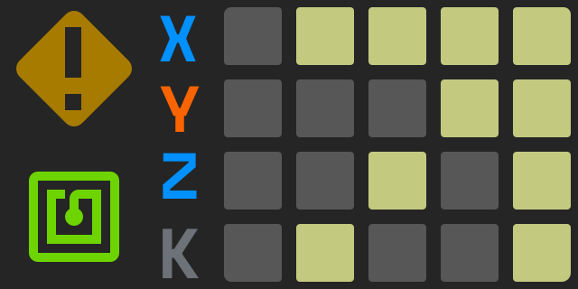

# LEDs

The extension sets the tool holder and UI LEDs from what it knows. `klipper/leds.cfg` has how each state looks (`_led_styles`); `TOOL_LEDS` redraws them and lists the states.

**The UI matrix** is a Pimoroni Unicorn pHAT: 8 × 4 RGB LEDs, Klipper's `[neopixel picam]` (`rpi:gpio15`, GRB), numbered 1 – 32 row by row from the top left. Each part has its own `led_effect` in `klipper/leds.cfg`:



```
  1  2 |  3 |  4  5  6 |  7 |  8      1 2 9 10      ui_alert        the machine's mood (below)
  9 10 | 11 | 12 13 14 | 15 | 16      3 11 19       ui_*stepper_*   the X, Y, Z endstops
 17 18 | 19 | 20 21 22 | 23 | 24      27            ui_key_*        K: the toolchanger's key, red locked, green open
 25 26 | 27 | 28 29 30 | 31 | 32      17 18 25 26   ui_tag          the tag reader
                                      cols 4 – 6    ui_tool_41..45  a tool's number in pixels (T0 is holder 41)
                                      16 24 32      ui_traffic_*    the tool change: red, yellow, green
```

The art (`led-matrix-ui.svg`, 40 px a LED) is what the matrix means: the alert sign over the top left 2 × 2, X Y Z K down column 3, the tag sign over the bottom left 2 × 2. The plot UI's *Display* panel shows the matrix and the dock strip live, from the LEDs' own colours in Klipper (`neopixel picam`, `neopixel indockator`), with the art over them and, from `printer.limn.leds`, what each part says.

| Where | State | Means |
|---|---|---|
| Dock strip, per holder | green | tool in its holder |
| | off | holder empty (its tool on the carriage, or missing), or holders unreadable |
| | red | the check at this holder failed |
| Fluidd tool buttons `T0`..`T4` | dot colour / highlight | green home, no dot empty, red failed / the carried tool (`tool_holder_macros` in `[limn]`) |
| UI digit | the tool's number: T0 (holder 41) shows 0 | |
| | blue, breathing | tool being changed |
| | amber / white | carried tool, tag not read / tag applied |
| UI column 8 (red, yellow, green) | red, yellow, green blinking, green | tool change: travelling, at the holder, leaving, done. Red blinking: failed, until the next change or `DOCK_RESET` |
| UI tag (bottom left) | blue blink / green / red blink | reading / applied / failed |
| | dim cyan, breathing / cyan, quick blink | listening for a pen held to the reader (a hand was on the holders) / a pen was scanned: into its holder now |
| | green / red blink | a holder took the scanned pen / it went in too late, or into two holders at once |
| UI alert (top left), most urgent first | red, fast then slow blink | a check failed or the holders can't be read (fast for the first 3 s) |
| | blue spinner, faster near the holder | tool change: travelling, at the holder, leaving |
| | cyan spinner | reading or writing a tag |
| | green, quick blink | a tool change just went well |
| | amber blink, slowing down over 5 s | a hand was on the holders |
| | amber, breathing | a tool is unaccounted for, or the carried tool's tag failed |
| | green, breathing | carrying a tool with its tag read: ready |
| | dim green, slow | all tools home |
| Holder, UI digit, UI alert | amber, orange, red, blinking faster; the alert's 2x2 goes round red and amber | a known pen has been out of its cap too long: its pen's `dry` minutes in `plot/profiles/pens.toml` (fineliners 10, the Stabilo 88's dry-safe ink 240), else 10 min (`tool_dry_idle`). The clock only runs while the machine leaves the pens alone: a print, G-code running (a calibration, a homing) or a tool change stops it, and the pen on the carriage starts afresh while it draws; a paused print doesn't. It beeps as a pen gets worse and once a minute meanwhile (`tool_dry_beep`). `TOOL_DRY` shows the clocks, `TOOL_DRY RESET=1 T=41` restarts one (primed), `SILENCE=1` stops the beeps; taking the pen out by hand stops its clock |
