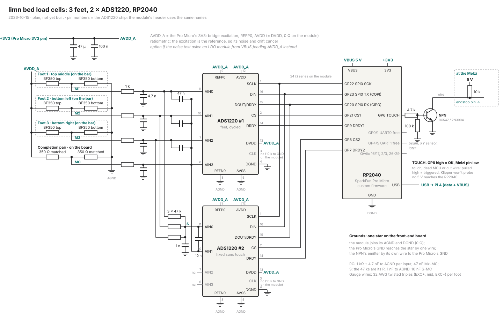
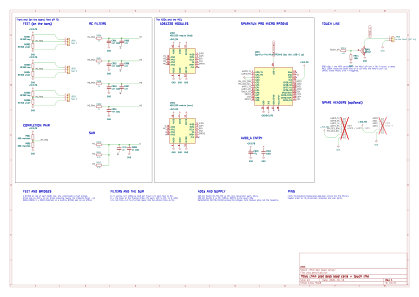
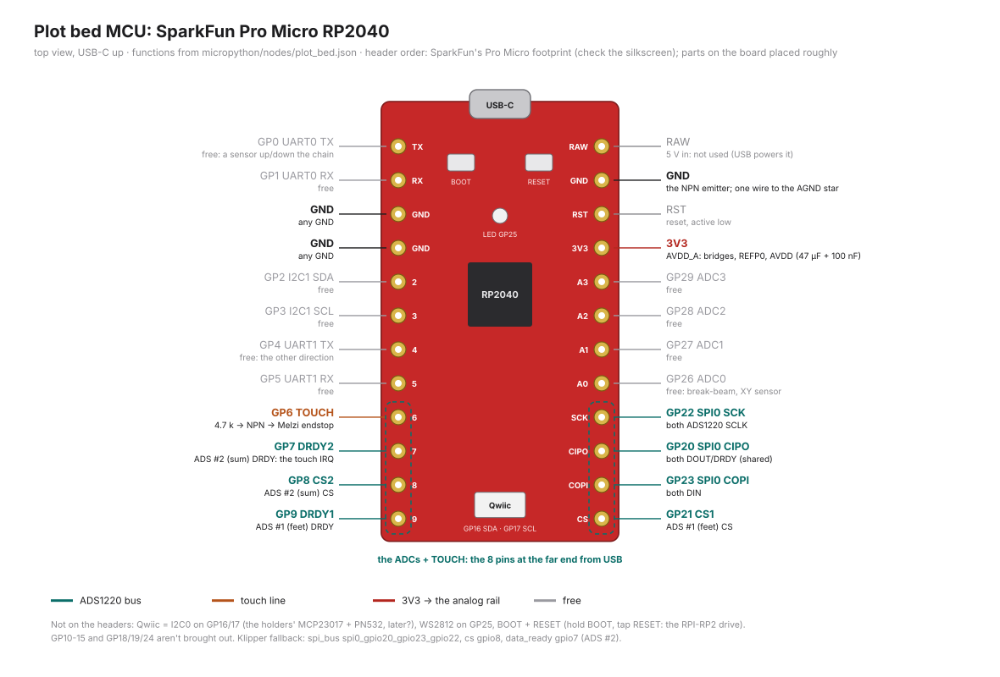
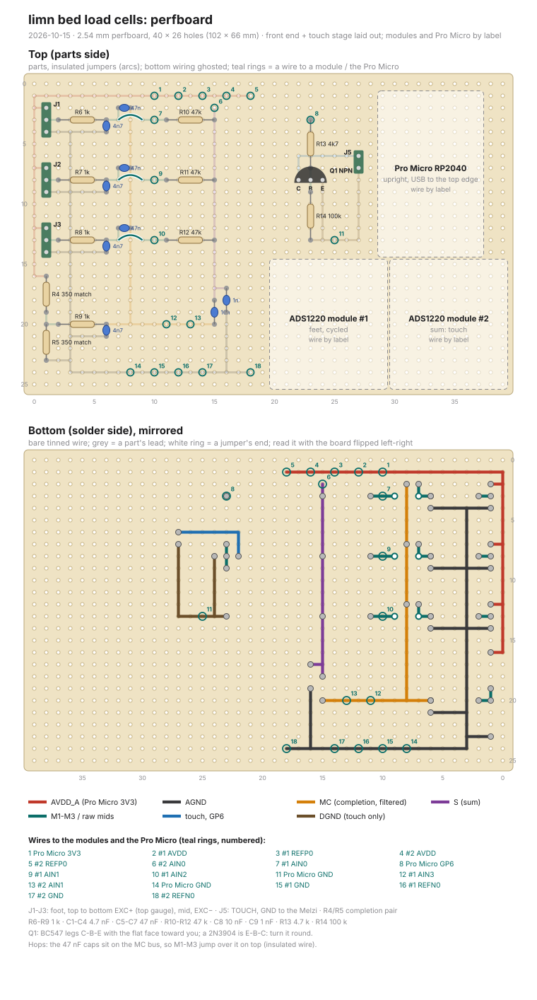

# Bed load cells: wiring (ADS1220 + RP2040)

2026-10-15. A plan, not built: set aside 2026-10-23 (the cell went to the toolchanger, 2026-10-16). The design: TODO.md, *Paper, pressure and the surface* (feet, the two ADCs, the touch line); the supply: [block-diagrams.md](block-diagrams.md), *Load cell: the ADS1220's supply and inputs*.



The SVGs come from `load-cell-wiring-svg.py` and `load-cell-perfboard-svg.py` (`python3 docs/<script> docs/<name>.svg`; the perfboard script also checks the layout for shorts).

## The schematic (KiCad)



The plot bed was the *Plot bed (load cells)* sheet of the machine's KiCad project, [docs/kicad/](kicad/README.md); it is set aside now (its drawing: `plot_bed_sheet` in `docs/kicad/kicad_gen/aside.py`, the SVG above: its last committed render): the Pro Micro with its header pins in their physical order, the two ADS1220 modules, the feet's gauges (off the board), the completion pair, the RC filters, the sum network, the NPN touch stage and two optional spare headers. The touch line's pull-up is on the *Melzi* sheet (R401, at the Melzi's end, on `PROBE_A4`). The modules' pin numbers are their list order, not the header's: renumber from a photo of the module.

## What's on it

- **3 feet** (top middle, bottom left, bottom right), each a half bridge: BF350 on top and bottom of the bar, between AVDD_A and AGND, midpoint M1-M3. 3 wires a foot (EXC+, mid, EXC−), twisted, 32 AWG.
- **Completion pair** on the board: 2 matched resistors (see *The completion pair* below), midpoint MC: the other half of every bridge.
- **ADS #1, feet cycled**: M1/M2/M3 on AIN0/1/2, MC on AIN3; firmware reads AIN0-AIN3, AIN1-AIN3, AIN2-AIN3 in turn. Per-foot load, point of pressure, sum.
- **ADS #2, the fixed sum**: the filtered M1-M3 through 3 × 47 kΩ into node S on AIN0, the filtered MC on AIN1; reads AIN0-AIN1 only. The steady, fast touch channel. AIN2/AIN3 free (a 4th foot, a temperature sensor).
- **Ratiometric**: REFP0/REFN0 on AVDD_A/AGND on both chips, so the excitation's noise and drift cancel.
- **AVDD_A = the RP2040 board's 3V3** (see *Supply* below), 47 µF + 100 nF where it enters the board. Feeds the bridges (~20 mA), REFP0 and the modules' AVDD (= DVDD on the module).
- **RC per channel**: 1 kΩ in series, 4.7 nF to AGND; on #1 a 47 nF from each foot's filtered node to the filtered MC (the three diff caps share MC). S: the 47 kΩs are its R (~16 kΩ together), 1 nF to AGND, 10 nF S–MC (corner ~1 kHz, fast enough for touch).
- **CLK**: not wired, the module pulls it to GND (internal oscillator).
- **Grounds**: one star on the perfboard's AGND rail: the RP2040 board's GND by one wire, each module's GND by one wire (the module joins AGND and DGND with a 0 Ω); the NPN's emitter by its own wire to the RP2040 board's GND.

## RP2040 pins



The board as you hold it (top view, USB-C up), every header pin with its use: `python3 docs/plot-bed-pinout-svg.py docs/plot-bed-pinout.svg`, read from `micropython/nodes/plot_bed.json`, so it follows the firmware. The header order is SparkFun's Pro Micro footprint as Zephyr maps it (left: GP0, GP1, GND, GND, GP2-9; right: RAW, GND, RST, 3V3, GP29-26, GP22, 20, 23, 21): the ADCs and TOUCH take the 8 pins at the end away from USB.

| GPIO | Use | Note |
|---|---|---|
| GP6 | TOUCH out | to the Melzi endstop through the NPN, see below |
| GP7 | DRDY2 | ADS #2 (sum), falling edge = sample ready |
| GP8 | CS2 | ADS #2 (sum) |
| GP9 | DRDY1 | ADS #1 (feet) |
| GP20 | SPI0 RX ← DOUT/DRDY (CIPO) | both (DOUT goes Hi-Z with CS high, so the bus can be shared) |
| GP21 | CS1 | ADS #1 (feet) |
| GP22 | SPI0 SCK | both ADS1220s |
| GP23 | SPI0 TX → DIN (COPI) | both |
| GP25 | WS2812 | on the board |
| GP16/17 | Qwiic (I2C0 SDA/SCL) | free: the user's ideas (the holders' MCP23017 and the PN532?) |
| GP0/1 | UART0 | free: a sensor up or down the chain, like the bed MCUs |
| GP4/5 | UART1 | free: the other direction |
| GP2/3, GP26-29 | | free: the break-beam (place not decided), an optical XY sensor, later |

**The board: a SparkFun Pro Micro RP2040** (the user's pick, 2026-10-16: it has a Qwiic port). It breaks out GP0-9, GP16/17 (Qwiic only), GP20-23 and GP26-29; GP10-15 aren't on its pins. So: SPI0 on its labelled SCK/COPI/CIPO/CS pins (GP22/23/20/21), the rest on GP6-9 along the same end of the other edge. Its config: `micropython/nodes/plot_bed.json`. The RP2040-Zero version (SPI1 on GP10-12, CS/DRDY GP13/14 and GP15/9, TOUCH GP8, chosen earlier the same day) is kept as `nodes/plot_bed_zero.json`.

No extra series resistors: the module has 24 Ω on MOSI, CS and SCLK, and the wires are short. GP20/23/22 is Klipper's `spi0_gpio20_gpio23_gpio22`, so the same board can run Klipper instead of the custom firmware without rewiring.

## ADS1220 pins (TSSOP-16)

| Pin | Name | #1 (feet) | #2 (sum) |
|---|---|---|---|
| 1 | SCLK | GP22 | GP22 |
| 2 | CS | GP21 | GP8 |
| 3 | CLK | nc (10 kΩ to GND on the module) | nc |
| 4 | DGND | DGND | DGND |
| 5 | AVSS | AGND | AGND |
| 6 | AIN3/REFN1 | MC | nc |
| 7 | AIN2 | M3 | nc |
| 8 | REFN0 | AGND | AGND |
| 9 | REFP0 | AVDD_A | AVDD_A |
| 10 | AIN1 | M2 | MC |
| 11 | AIN0/REFP1 | M1 | S |
| 12 | AVDD | AVDD_A | AVDD_A |
| 13 | DVDD | AVDD_A (0 Ω on the module) | AVDD_A |
| 14 | DRDY | GP9 | GP7 |
| 15 | DOUT/DRDY | GP20 | GP20 |
| 16 | DIN | GP23 | GP23 |

**The modules** (the common ADS1220 breakout, as described by [Wolles Elektronikkiste](https://wolles-elektronikkiste.de/en?p=15776)): headers labelled MISO (DOUT/DRDY), MOSI (DIN), SCLK, CS, DRDY, CLK, AVDD, AGND, DVDD, DGND, REFP0, REFN0, AIN0-AIN3. On the board: 0 Ω from DVDD to AVDD and from DGND to AGND, caps on AVDD and DVDD, 24 Ω on MOSI/CS/SCLK, CLK to GND through 10 kΩ, no regulator. So: one supply wire (AVDD), one ground (AGND), REFP0/REFN0 wired to the perfboard's rails. The header order isn't known to me: the perfboard leaves a zone per module and numbers the wire ends instead.

## Supply: the Zero's 3V3 (the user's question, 2026-10-15)

**Yes, start on the Zero's 3V3.** With the excitation as the reference (REFP0/REFN0 across the same rail as the bridges), the ADC reads the bridge's *ratio*: a mid at 0.5000 × AVDD_A reads the same whether AVDD_A is 3.28 or 3.31 V, and its ripple appears in the signal and the reference alike. What's left of the supply's noise is that noise × the bridge's imbalance (a few mV of offset × 0.1 % of ripple ≈ a few µV before the ADC's averaging), small next to ~16 µV per 10 g, and the input RC + the ADC's filter take most of it.

- The FSR comparison only half holds: its signal was hundreds of mV, the feet's is µV, so the ratiometric wiring is what makes the shared 3V3 fine, not that the FSR coped.
- The Zero's regulator gives ~300 mA (Waveshare's figure); the RP2040 + bridges + modules take ~50 mA. The Pro Micro has its own 3.3 V LDO (its rating: SparkFun's datasheet); ~50 mA is light for either.
- Test it: foot 1 on ADS #1 at 20 SPS, no load: the reading's noise in counts. Well under a gram's worth (~1.6 µV): done. If not, the LDO module.
- **An LDO module** (asked: yes, then no separate caps; it has its own input/output caps). From VBUS (the Zero's 5V pin) to AVDD_A, the Zero's 3V3 then only for the RP2040. A common AMS1117 module wants ≥ ~4.4 V in (USB gives ~4.8-5 V: tight) and isn't low-noise, but ratiometric that matters little. The AliExpress link didn't open for me: the module's name or a photo, and I'll check it.

## Perfboard



The analog front end (feet connectors, completion pair, RC, the summing network) and the touch stage are laid out hole by hole; the two modules and the Pro Micro get a zone each and are wired by the numbered rings (the list under the drawing), until I have the modules' header order.

- **Two views**: the top with the parts, the bottom mirrored with the bare wire, as you see it when soldering.
- **Rails**: AVDD_A along column 0 and row 1, AGND along column 3 and row 24. The 1 kΩs lie across the AGND column (the body over it, the bus under the board).
- **Hops**: the 47 nF caps sit on the MC bus (column 8), so M1-M3 jump over it on top with 3 short insulated wires.
- **Q1**: BC547 legs C-B-E with the flat face toward you; a 2N3904 is E-B-C, turn it round.
- **Connectors**: J1-J3 3-pin (JST-XH or a header), top to bottom EXC+ (top gauge), mid, EXC− (bottom gauge); J5 TOUCH + GND to the Melzi.
- **Parts**: R4/R5 the completion pair (below), R6-R9 1 kΩ, C1-C4 4.7 nF, C5-C7 47 nF, R10-R12 47 kΩ, C8 10 nF, C9 1 nF, R13 4.7 kΩ, R14 100 kΩ, Q1 NPN, 47 µF + 100 nF at the AVDD_A entry (ring 1). Ceramic C0G/NP0 for the 4.7 nF and 1 nF if you have them.

## The completion pair: no 0.1 % needed (2026-10-15)

The pair's *mismatch* is only an offset, and tare removes it; what matters is that it stays put. At gain 128 with the 3.3 V reference the input range is ±25.8 mV.

- **1 % parts**: up to ~8 mV of offset (3.3 V / 4 × 1 %), a third of the range: it fits. Better: measure a handful from one strip with the multimeter and keep the two closest (the meter's accuracy doesn't matter for comparing, its last digit does). Any value from ~350 Ω to 1 kΩ, both the same.
- **Drift is the real cost**: two 1 % metal films from one batch differ by maybe 10-20 ppm/K in tempco, ~8-16 µV/K at the midpoint, ~5-10 g per kelvin. Harmless for touch (a change over a fraction of a second), visible over minutes in absolute grams: re-tare. Keep the two touching (glued together, or bent so the bodies touch), away from the board's regulator.
- **Best, with parts on hand: a dummy pair of BF350s** glued top and bottom on an unloaded offcut of the same 6061 strip, wired like a foot (EXC+, mid, EXC−) into the completion position. Same foil, same glue, same aluminium: it drifts with the feet and cancels it. Keep it under the bed near the feet, not on the board. Then R4/R5 aren't fitted: its 3 wires go into their holes, EXC+ at R4's top (1,16), mid at the joint (1,19), EXC− at R5's bottom (1,23).
- 0.1 % 25 ppm/K resistors (or a matched network) are the buy-it option: ~5x less drift than 1 % parts, not needed to start.

## The touch line

**One NPN, open collector** (BC547, 2N3904, S8050: any small NPN). GP6 → 4.7 kΩ → base, 100 kΩ base to DGND, emitter to DGND, collector down the wire to the Melzi's endstop pin, **pulled up to the Melzi's 5 V at the Melzi end** (10 kΩ, or Klipper's internal `^`, ~20-50 kΩ: the external one is quieter on a long wire).

- GP6 high = OK: the NPN conducts, the Melzi pin is low (~0.1 V).
- Touch (GP6 low), RP2040 dead, unpowered, rebooting (100 kΩ holds the base low), or the wire cut: the pull-up wins, the pin is high = **triggered**, and Klipper refuses to probe. Fail-safe in every case.
- No level problem: the RP2040 only drives a base; the 5 V never reaches its pin, and with the Melzi off with the slide switch there's no path back either. The old 2 kΩ isn't needed for that any more.
- Klipper: `endstop_pin: ^<pin>` (or without `^` with the external 10 kΩ), no `!`: high = triggered is Klipper's default.
- Firmware: GP6 high = OK (`touch_out` in node.json); it also reads touched while taring, without ADC samples, or after an error.
- Speed: ~1 µs rise (10 kΩ × ~100 pF of wire), nothing next to Klipper's endstop sampling.

An N-MOSFET works the same way (BSS138; a 2N7002 can need up to 2.5 V on the gate, marginal at 3.3 V), gate through 100 Ω, the 100 kΩ gate to ground.

**The 74AHCT1G125 is no longer needed.** It was for the first version (a push-pull 3.3 V line into a 10 kΩ pull-down gives 2.75 V, under the ATmega1284P's 3.0 V input high). The open collector is simpler and also catches a cut wire, which the push-pull line didn't.

## Firmware: `lrt_plot_bed` (2026-10-16)

MicroPython, like the Dock and the bed MCUs: `micropython/lrt_plot_bed.py`, `micropython/lib/ads1220.py`, pins and defaults in `micropython/nodes/plot_bed.json`. Same bootloader, updates with rollback, error guard and USB lines as the others (`micropython/STRATEGY.md`). It's on the Pi's USB alone, so it is hop 0; with `"up"`/`"down"` in its node.json it joins a chain like any bed node.

```
uv run micropython/mcu.py install plot_bed --port <port>     # once, over USB
uv run micropython/mcu.py monitor --port <port>              # samples, logs
uv run micropython/mcu.py send 'diag()' --port <port>
uv run micropython/mcu.py update --hop 0 --port <port>       # later updates, rolled back if it doesn't start
```

- **Sum (ADS #2)**: continuous, 330/s, AIN0-AIN1, read in a **hard IRQ on DRDY2**, which also averages the last 4 samples, compares them with `threshold_g` (5 g, released under `release_g`, 3.5 g) and sets the touch line. Measured on the Pro Micro (2026-10-16): USB prints and the GC hold the main loop 3-25 ms, 8 samples at 330/s; the IRQ (~155 µs with its SPI read) runs through them. The main loop drains a 64-sample ring for tares, jobs and the stream; feet SPI traffic masks the IRQ. `stall(<ms>)` busies the main loop to show it.
- **Feet (ADS #1)**: one conversion per foot, AIN0/1/2 against AIN3, 20/s (the 50/60 Hz filter): ~6.7 readings a foot per second.
- **Tare**: at boot, on `tare()` (or `calibrate()` without a weight), and on `arm(plot_bed)` (the sum only, 0.25 s). While nothing presses (under half the release, not armed) the tare follows drift slowly (5 s). A load that stays (the frame, a weight) is not tared away: `tare()` from the host.
- **Touch line**: touched (GP6 low) while pressed, while taring, before the first tare, when the sum ADC gives no samples for 200 ms, and after a loop error. `arm(plot_bed)` tares, then answers `!LRT>>armed>>{"armed": true, ..}>>`; `disarm()`.
- **Grams**: from an estimate (~510 counts/g a foot, ~170 on the sum) until calibrated. With the bed tared empty: `calibrate(<g>)` with a known weight anywhere (sum, and the feet with one common gain), then `calibrate(<g>, <foot 1-3>)` with the weight over each foot for its own gain. Kept in `cal.json` on the board; updates don't touch it.
- **Samples** (`stream(on|off)`, `rate(<Hz>)`, 25/s; and on every touch edge): `!LRT>>data>>{"hop": 0, "kind": 6, "state": 42, "values": [flags, sum_mg, sum_raw, [[foot_mg, foot_raw] x 3]]}>>`. Flags: 1 touched, 2 armed, 4 calibrated, 8 sum ADC ok, 16 feet ADC ok, 32 taring.
- **`diag()`**: per chip the register readback, set and measured rate; tares, counts/g, threshold, longest loop; then after 2 s the noise in counts, µV and g per channel: the bench noise test above.
- **On the board (2026-10-16)**: MicroPython v1.29.0 (SPARKFUN_PROMICRO), `install plot_bed` and `update` over USB work; with no chips both are reported missing and the line reads touched. Lesson: `time.sleep_ms()` with interrupts disabled never returns on the RP2040 (the chip setup did, under the bus lock): it hung until the watchdog, every boot. The driver busy-waits instead; the board was recovered by parking `main.py` right after a reset.
- **A missing chip** is reported (`adc>>sum: reset state ff ff ff ff`) and set up again every 3 s; the other keeps working. So foot 1 on the bench works with only ADS #1 wired (the touch line then reads touched: no sum).

Foot 1 on the bench: ADS #1 alone, foot on AIN0 + the completion pair on AIN3; `diag()` for the noise with nothing on it, then coins with `monitor` (foot 1's mg and raw).

## Firmware: `limn_lit` (2026-10-24)

LIT (*lit*, bed in French) runs the plot bed board as built: one ADS1220 for the toolchanger's cell, the touch line, and the bed dock the Dock MCU used to do. `micropython/limn_lit.py`, pins in `micropython/nodes/lit.json`; `lrt_plot_bed` and `lrt_dock_mcu` are left as they were.

```
uv run micropython/mcu.py install lit --port <port>
uv run micropython/mcu.py send 'diag()' --port <port>
```

- **Cell**: as the plot bed's sum (IRQ on DRDY GP7, 330/s, avg of 4, 5 g / 3.5 g, tare and drift, `arm(lit)`), no feet: samples are kind 6 with an empty feet list. `calibrate(<g>)` only; ~236 counts/g until then.
- **Bed**: ID on GP29 (the Dock's table), BED_EN GP4 high once the same bed reads 1 s, low after 250 ms gone; `power_on()`, `power_off()`, `read_bed_id()`. BED_PROBE on GP1 is only reported (`bed_probe` lines): Q952 already puts it in series with the touch line.
- **+5V_SW**: `sw5v(on|off)`, off at boot. **Tool ID**: `tool()` reads GP26 (GP27 left off).

## Klipper, if ADS #2 goes on a Klipper MCU instead

Klipper's driver takes REF0 and any input pair (checked in `reference/klipper/klippy/extras/ads1220.py`), so the ratiometric sum works there too:

```ini
[load_cell_probe]
sensor_type: ads1220
spi_bus: spi0_gpio20_gpio23_gpio22
cs_pin: loadcell:gpio8
data_ready_pin: loadcell:gpio7
gain: 128
input_mux: AIN0_AIN1
vref: REF0
sample_rate: 330
```

DRDY must be on the same MCU as the SPI bus. ADS #1 (cycled feet) stays custom: Klipper reads one fixed pair per sensor.

## Small things

- **Sign**: pressing a tip down puts the top gauge in tension, its resistance up, the midpoint down. Same on all 3 feet as long as each is wired top-to-EXC+; the sign is a firmware constant.
- **Summing crosstalk**: the 47 kΩs connect the filtered nodes (~1.2 kΩ each: the 1 kΩ + the bridge), so ~1.3 % of one foot shows on the others on ADS #1 (10 kΩ would have been ~6 %). Fine for the point of pressure, and a per-foot calibration takes it out anyway.
- **Feet mismatch**: each foot weighed on the bench; the sum on #2 is equal-weighted, so a 5 % weaker foot is a 5 % XY-dependent error on #2 (#1 corrects it per foot).

## Checks

- [ ] The modules' header order (a photo of both sides): then the perfboard gets their footprints.
- [ ] The Pro Micro's pins against SparkFun's graphical datasheet before soldering (my table is from its CircuitPython pin file).
- [ ] The Melzi endstop input: an onboard pull-up (then no extra 10 kΩ) or an RC filter (fine, a little slower).
- [ ] Completion pair: a dummy BF350 pair on an offcut (my pick), or 2 matched 1 % from one strip.
- [ ] Foot 1 on the bench on ADS #1 (AIN0-AIN3) before building all three.
