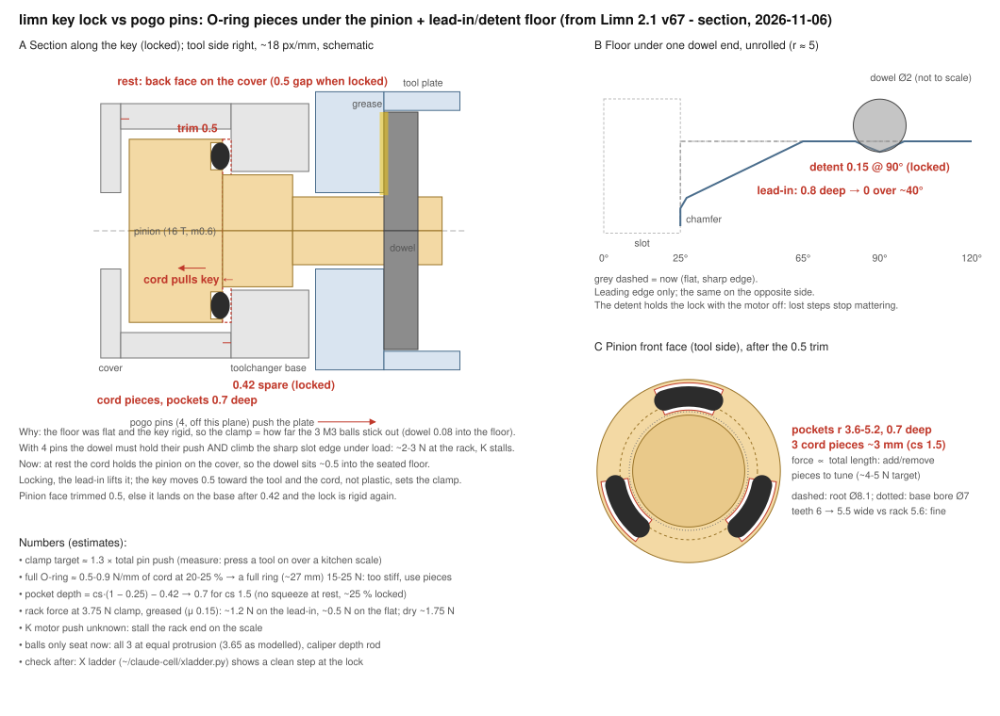
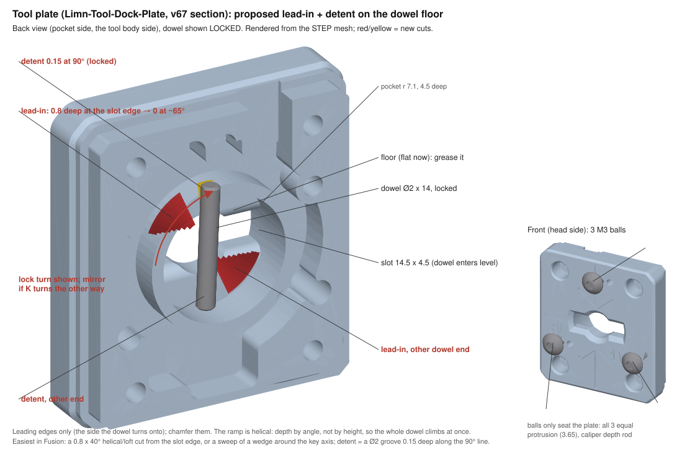

# Key lock vs pogo pins (2026-11-06)

From `Limn 2.1 v67 - section.step`. The floor the dowel bears on is flat (no lead-in) and the key is rigid, so the clamp is set by how far the 3 M3 balls stick out (dowel 0.08 into the floor). The 4 pogo pins push the plate off: the dowel must hold them and climb the sharp slot edge under load, and K stalls.

Plan:
- Pinion: trim the front face 0.5, 3 pockets (r 3.6-5.2, 0.7 deep for cs 1.5) with ~3 mm pieces of the RB001 O-ring cord. The cord holds the pinion on the cover at rest. A full ring is too stiff (~15-25 N). Tune by the number of pieces, target ~1.3 × the pins' push (~4-5 N).
- Plate: 0.8 deep lead-in at both leading slot edges over ~40°, a flat, and a 0.15 detent at 90°. Chamfer the edges. The balls then only seat the plate: set all three to equal protrusion with the caliper.
- Grease the floor.
- Measure: the pins' push (tool pressed on over a scale), and K's rack push (stalled on the scale).
- Check after with the X ladder (`~/claude-cell/xladder.py`).

Numbers are estimates: rack ~1.2 N on the lead-in, ~0.5 N on the flat (3.75 N clamp, greased).
