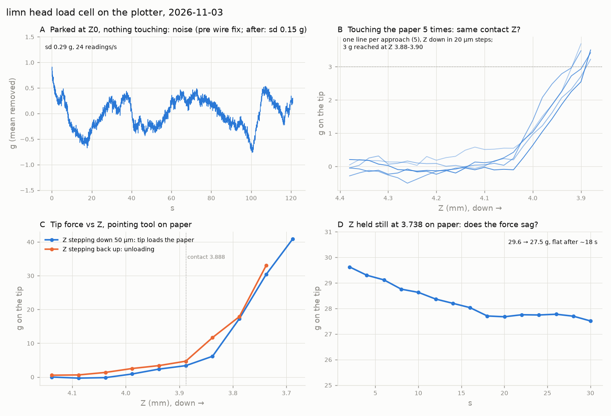
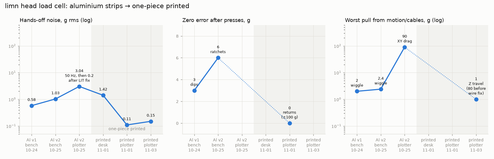

# Head load cell

The pen's force is measured at the head: a strain-gauge parallelogram between the Z rider and the toolchanger connector, read by LIT. Any tool becomes a probe, and writing force (20-40 g, a light line 5-10 g) can be logged and controlled instead of guessed from Z.

**The cell.** One printed piece (LimnZ-LoadCell41): a parallelogram 32 x 10.9 x 10 with two 2.4 mm beams over a 19 x 6.1 window, r 0.5 root fillets; the moving block is merged into the toolchanger connector, the fixed block screws to the rider's tab. 4 BF350 on the outer faces at both ends (top A/B, bottom C/D, opposite arms): the bridge reads the moment difference = shear, so drag and pen position cancel. 350 Ω, GF 2, ratiometric into an ADS1220 at 600/s, mean of 12 (one 50 Hz period). Model (E ~3.5 GPa): ~41 µε per 40 g, ~10x the old Al strips' strain, k ~90 N/mm (~4 µm at 40 g). Wires leave from the fixed block, nothing crosses the cell. ~63 g of head hangs on it. Scale ~1280 counts/g, linear to ≤ 0.2 g.

**What it does.** Rest noise 0.11-0.15 g rms, no drift. Z travel without contact stays within ±1 g. On paper, contact repeats to the 20 µm step (5/5 at z 3.88-3.90), a soft 0.15 mm toe to ~6 g, then ~25 g per 0.1 mm. Lifting reads 1-5 g above pressing; a 30 g hold relaxes ~7 % and settles in ~18 s. Tare at Z ≤ 2-4 after homing (the Z switch loads it a few g), and at every pen-up. Good as a probe and for a relative force loop; absolute scale not re-checked. Next: force while drawing.

**Why it's built this way** (all runs in detail: [cell-test/cell-runs.png](cell-test/cell-runs.png)):

- *Aluminium strips → one printed piece.* The first cells were 6061 strips (32 x 10 x 1.5, ~29 µV/40 g) in printed clamps with metal standoffs: stiff beams, soft clamps, joints in the strain path. They slipped: −2..−3 g dips after release (v1), then with the cell flipped a zero that ratcheted +2..+6 g after hard presses and stayed (v2), i.e. false triggers. One printed body has no joint; plastic creeps and drifts with heat, but slowly, and a tare at every pen-up takes that out.
- *Gauges at both ends, outer faces*: drag and pen offset cancel, no inner faces to glue.
- *Wiring*: 50 Hz pickup (3 g) is gone with the per-period mean. Cable drag (±90 g with XY) and a caught cable (−80 g in Z) are gone with the FFC + CAT6 and re-routed wires.

Data `cell-test/*.json`, `cell-test/20261103-pi/`; plots `cell-test/plot_runs.py`.
