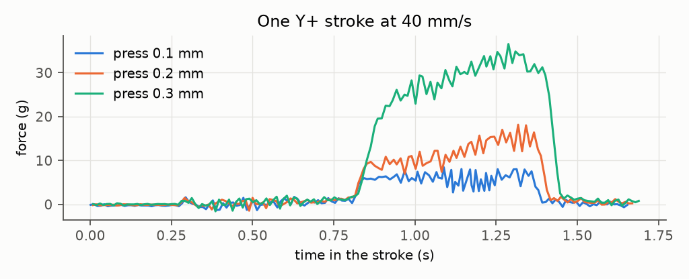
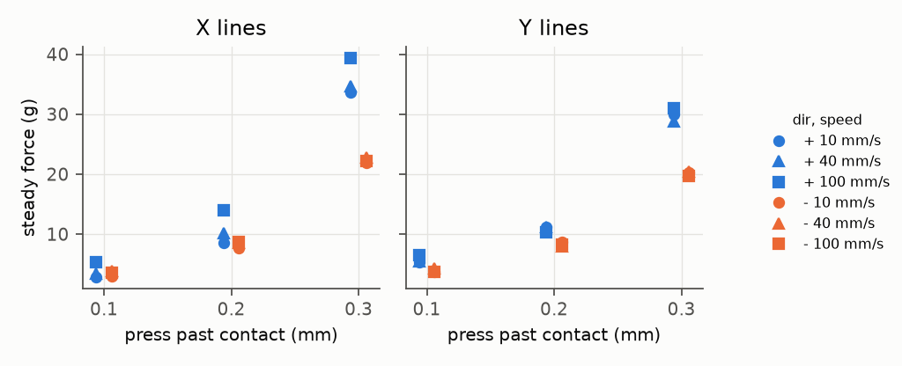
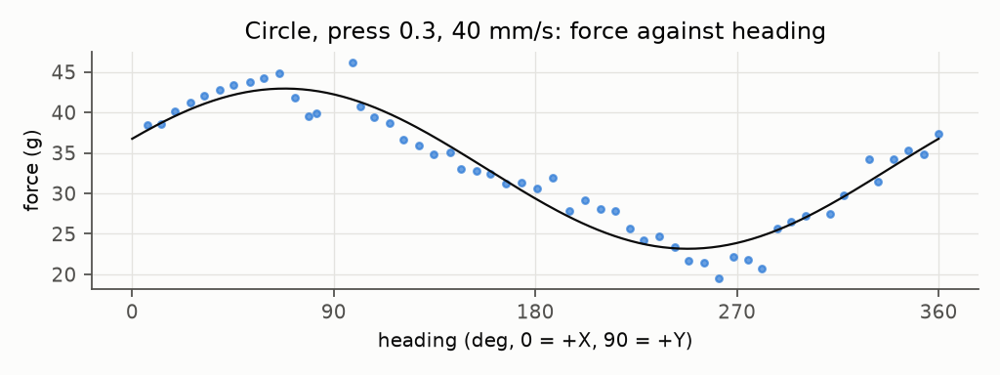
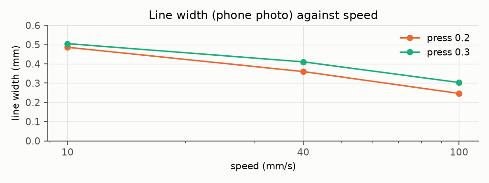

# Pen force while drawing (2026-11-07)

T3 Stabilo (stb-88, worn), holder 44, new ramp plate. Head cell on LIT at 100 Hz plus Klipper's trapq on one clock (`penrec.py`), so every sample has a position and speed. Each stroke is drawn once 0.6 mm above contact (the air pass, the baseline) and then inked. Z follows a plane fitted to 5 contact points (knee of a 0.02 ladder, repeats ≤ 0.04, residual ≤ 0.04).

Touchdown at 5 mm/s overshoots, up to +26 g at press 0.3: that's the blob at stroke starts. Force also climbs along this Y+ stroke (0.3: 20 → 35 g), so the plane is off by ~0.1 along Y or the tool tilts.

~4 / 9.5 / 27 g at 0.1 / 0.2 / 0.3, non-linear (the soft toe). Speed barely matters. Direction does: + strokes are heavier, by up to 1.7× at 0.3. Ripple is 1–3 g sd, up to 5 g on pulled strokes at 0.3. No resonance within the cell's ~25 Hz.

Heading explains the circle: 33 ± 10 g, heaviest toward +X/+Y (~70°), residual sd 1.8 g. Tool tilt or drag torque on the cell? Not separated yet. At press 0.1 the circle inks only part of the loop.

Width from the phone photo (`~/limn-shot/IMG_7490.JPG`, `widths.py`, 39.6 px/mm). Width follows speed, not force: ×3 force adds ~0.03 mm, 10× speed halves the line. A worn felt tip is limited by ink flow.

First run: the DOCK pickup left the tool ~1.1 mm high. A 6 g X− stroke knocked it into its seat, then strokes pressed 110–170 g and the tool came off. Pen contact height can check the seat after a pickup.

Holder 44 dock scans (carried tool, empty holder, `dockscan.py`): Y ≈ 135.3 (macro 136), Z ≈ 8.2 (8), switch at X ~175.5 (176). ±50–70 g floor from sag and the cradle self-centring.

Files: `pen-draw-*.jsonl` (`['c', t, g, flags]` samples, `['q', …]` trapq), `pen-contact-*.jsonl`, `plane.json`. `uv run --with numpy --with matplotlib python plots.py`.
